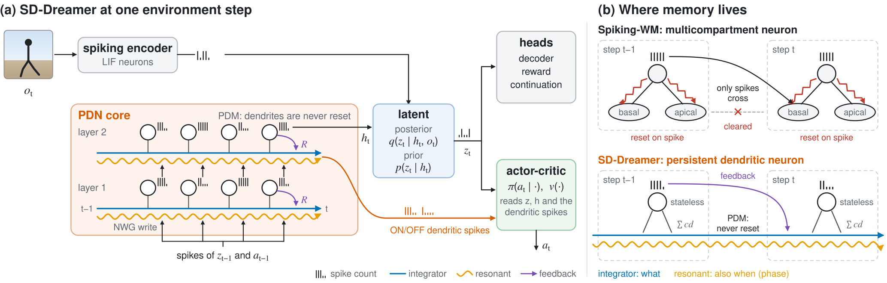

# SD-Dreamer: Spike-Driven Dreamer

Spike-Driven Dreamer (SD-Dreamer) is a spiking world model for model-based reinforcement learning in partially
observable tasks. Its recurrent core is built from persistent dendritic neurons: dendrites store memory and spikes
communicate it.

- **Persistent Dendritic Memory (PDM).** Integrator and resonant dendritic channels carry their state across
  environment steps. Spikes write into them and never reset them. Integrators hold what the agent has seen;
  resonators also record when it happened.
- **Normalized Write Gain (NWG).** A channel with decay λ writes with gain √(1 − λ²), so channels of every
  retention time, from 1 to 1000 environment steps, stay on the same scale.
- **Stateless soma.** Each neuron's soma reads its dendritic channels and sends a spike count over the T = 5 SNN
  steps of an environment step. This spike count is the only signal that passes between neurons.

<p align="center"></p>

The agent follows DreamerV3: a spiking encoder, the recurrent core above, a latent posterior and prior, decoder,
reward and continuation heads, and an actor and critic trained in imagination. The actor and critic read the
latent state and the dendrites of the core as ON/OFF spikes.

## Repository layout

```
.
├── dreamer.py             RL training entry (DreamerV3 loop)
├── models.py              world model, actor and critic, imagination
├── networks.py            RSSM and its recurrent cores: PDRNN (SD-Dreamer), MCRNN (Spiking-WM), LIFRNN,
│                          GRSNCell, DHSNNCell, TCLIFCell, GRUCtrl; spiking encoder and decoder
├── node.py, surrogate.py  spiking neurons (LIF, multicompartment) and surrogate gradients
├── normalization.py       normalization layers (PopNorm)
├── tools.py, exploration.py, parallel.py
│                          logging, replay, environment workers (from dreamerv3-torch)
├── probe_wm.py            world-model memory probe: cue recall on BSuite and POPGym
├── probe_mm.py            Memory Maze offline probing benchmark
├── energy.py              operations and energy per environment step
├── configs.yaml           defaults and named config blocks
├── envs/                  BSuite memory length, POPGym, DeepMind Control
├── scripts/
│   ├── train.sh           SD-Dreamer on one task with the settings of the paper
│   ├── make_jobs.py       every run of the paper -> runs/jobs.jsonl
│   ├── queue.py           GPU job queue (CUDA MPS, memory budget per GPU)
│   ├── main_tables.py     result tables from runs/ -> docs/RESULTS.md
│   ├── review_configs.py  checks that all models of a benchmark share its protocol settings
│   ├── summarize.py       probe summaries and plots of the reset interventions (docs/PHASE0.md)
│   ├── run_r2i.sh         R2I baseline (official code) on POPGym
│   ├── data/              Memory Maze download and preparation
│   └── diag/              diagnostics referenced in docs/EXPERIMENTS.md
├── docs/
│   ├── EXPERIMENTS.md     experiment log: every run, result and design decision
│   ├── PHASE0.md          causal interventions on Spiking-WM (reset amnesia)
│   └── RESULTS.md         current result tables (generated by scripts/main_tables.py)
├── paper/                 LaTeX source of the paper (paper/README.md)
├── assets/                README figure
├── external/              third-party code (not tracked): Recall2Imagine
├── data/                  datasets (not tracked)
└── runs/                  logs and checkpoints (not tracked)
```

## Installation

```bash
conda env create -f environment.yml
conda activate sd-dreamer
pip install -r requirements.txt
```

Python 3.10, PyTorch 2.4.1 with CUDA 12.4. DeepMind Control from pixels renders with OSMesa
(`MUJOCO_GL=osmesa`, set by `scripts/train.sh`).

**Memory Maze data.** The official Memory Maze 9x9 offline dataset (Pasukonis et al., 2023), read directly from its
zip archives:

```bash
bash scripts/data/download_memory_maze.sh eval train-part0 train-part1 ... train-part9   # -> data/memory_maze_9x9_official
```

**R2I baseline.** Clone [Recall2Imagine](https://github.com/chandar-lab/Recall2Imagine) (commit `6e317e7`) into
`external/Recall2Imagine`, install its environment, and run
`R2I_PYTHON=<its python> bash scripts/run_r2i.sh RepeatPreviousEasy <gpu> <logdir>`.

## Training

`scripts/train.sh <task> [seed] [logdir]` runs SD-Dreamer with the settings of the paper:

```bash
bash scripts/train.sh bsuite_memlen-101             # BSuite memory length 101 (protocol of R2I), 1M env steps
bash scripts/train.sh popgym_RepeatPreviousMedium   # POPGym RepeatPrevious, 2M env steps
bash scripts/train.sh dmc_walker_walk               # DMC walker from proprioception, 500k env steps
bash scripts/train.sh dmcpix_walker_walk            # DMC walker from pixels, 1M env steps
bash scripts/train.sh bsuite_memlen-64-recall       # world model alone: recall of a cue 64 steps back
bash scripts/train.sh memory_maze_9x9               # Memory Maze offline probing, 1M updates
```

The full list of tasks is in the header of `scripts/train.sh`. Each task maps to one command, for example

```bash
python dreamer.py --configs bsuite ours resonanthalf policymem aclowrank somathermo pdfeedback pdch2 rewardbyact \
  --task bsuite_memlen-101 --steps 1e6 --train_ratio 64 --reward_head symlog_mse --batch_length 128 \
  --eval_every 20000 --env_seed_per_env True --seed 0 --logdir runs/sd-dreamer/bsuite_memlen-101/s0
```

A run writes `metrics.jsonl` (training and evaluation metrics), TensorBoard events and `latest_model.pt` to its
logdir; `probe_mm.py` writes `model.pt` and resumes from it.

### Models and config blocks

`--configs` takes the benchmark block (`bsuite`, `popgym`, `dmc_proprio`, `dmc_vision`, `mmprobe`) followed by the
blocks of the model. SD-Dreamer uses the same configuration on every task:

| Block | Effect |
|---|---|
| `ours` | two-layer PDRNN core whose state is carried across environment steps |
| `resonanthalf` | half of each neuron's dendritic channels resonant, half integrators |
| `pdch2` | two dendritic channels per neuron |
| `somathermo` | stateless soma that sends a spike count over the T SNN steps |
| `pdfeedback` | dendrites also receive the layer's own spikes of the previous step |
| `policymem` | actor and critic also read the dendrites as ON/OFF spikes |
| `aclowrank` | rank-64 weights from these dendritic spikes to the actor and critic |

Baselines share the world model and differ only in the recurrent core:

| Model | Blocks | Core |
|---|---|---|
| SD-Dreamer | `ours resonanthalf policymem aclowrank somathermo pdfeedback pdch2` | `PDRNN` |
| Spiking-WM (Sun et al., 2025) | none | `MCRNN` |
| LIF | `lifcell` | `LIFRNN` |
| GRSN (Qin et al., 2025) | `grsn` | `GRSNCell` |
| DH-SNN (Zheng et al., 2024) | `dhsnn` | `DHSNNCell` |
| TC-LIF (Zhang et al., 2024) | `tclif` | `TCLIFCell` |
| DreamerV3 (ANN) | `grucell annwm` | `GRUCtrl` |
| Spiking-WM + A+B+G (intervention) | `persist nodendreset taud128 dendgain` | `MCRNN` |

On BSuite every model adds `rewardbyact` (reward head indexed by the action). On Memory Maze, which has no actor or
critic, SD-Dreamer drops `aclowrank`. The world-model probes (`probe_wm.py`) use the world-model blocks
`ours resonanthalf somathermo pdfeedback pdch2`.

## Reproducing the paper

```bash
python scripts/make_jobs.py                                  # every run of the paper -> runs/jobs.jsonl
setsid nohup python scripts/queue.py --jobs runs/jobs.jsonl --gpus 0,1,2,3 --max_per_gpu 10 --budget_gb 100 \
  > runs/queue.stdout 2>&1 &                                 # runs them; status in runs/jobs.status
python scripts/main_tables.py                                # tables -> docs/RESULTS.md
cd paper && make data && make                                # paper figures, tables and PDF
```

Runs are stored as `runs/<group>/<task>/<model>/s<seed>/`. The groups of the paper:

| Group | Content |
|---|---|
| `rl3` | BSuite memory length 8 to 64, RL |
| `r2i` | BSuite memory length 51, 71, 101 with the protocol of R2I, RL |
| `popgym` | POPGym RepeatPrevious Easy and Medium, RL |
| `recall` | world-model probes: recall of a cue L steps back |
| `mmaze_official` | Memory Maze 9x9 offline probing |
| `dmc500` | DMC from proprioception, 500k env steps |
| `dmcpix`, `dmcpix1m` | DMC walker from pixels, 1M env steps (baselines in `dmcpix`, SD-Dreamer in `dmcpix1m`) |

`scripts/main_tables.py` maps run directories to model names (SD-Dreamer is `PD2Lv2r64thermofbch2_tau1000`, on
Memory Maze `PD2Lv2thermofbch2_tau1000`). `energy.py --configs <run's blocks> --task <task> --logdir <run dir>`
counts the operations and energy of a trained agent and writes `energy.json` next to it.

## Acknowledgements

The code builds on [dreamerv3-torch](https://github.com/NM512/dreamerv3-torch) and on the code of
[Spiking-WM](https://github.com/Brain-Cog-Lab/Spiking-WM) (Sun et al., PNAS 2025), which is also our main
baseline. We thank the authors of Recall2Imagine, Memory Maze, BSuite, POPGym and the DeepMind Control Suite, and
of the GRSN, DH-SNN and TC-LIF neurons, for releasing their code.

## License

Apache License 2.0, see `LICENSE`.
